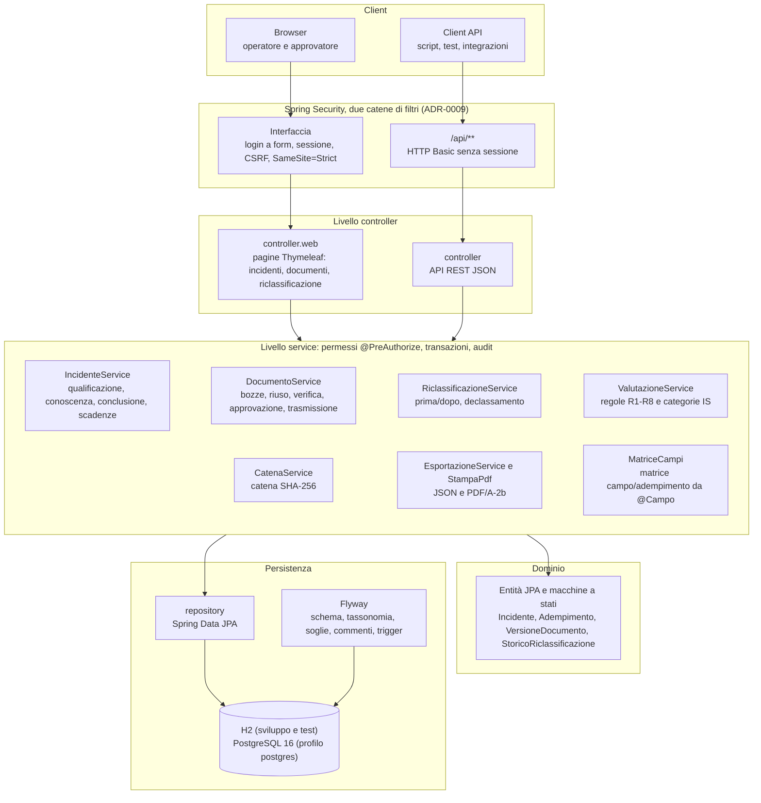
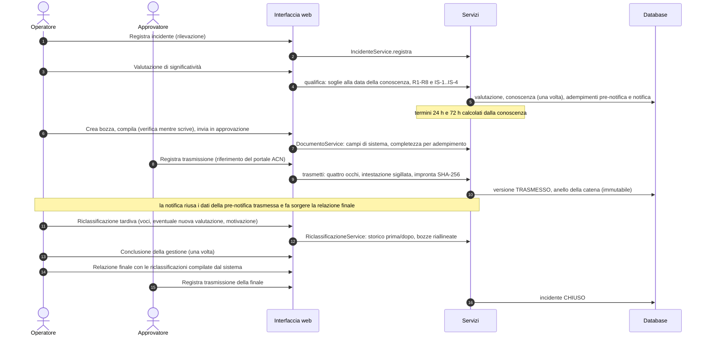
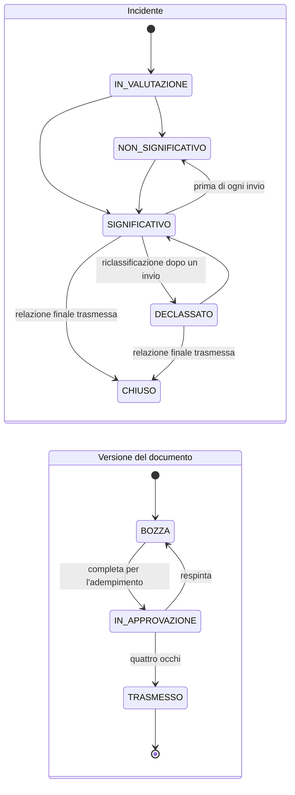
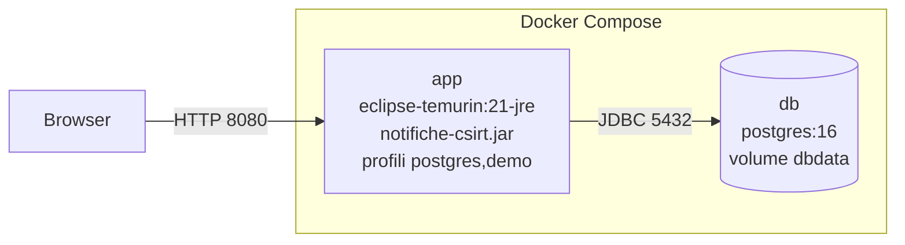

# Architettura

Applicazione Spring Boot monolitica a livelli, con due punti d'ingresso (interfaccia web e API REST) sopra gli
stessi servizi. Le figure sono in Mermaid; le versioni SVG e PNG per la relazione sono in `docs/figure/`.

## Componenti e livelli

I controller, web e REST, usano solo i servizi; i repository sono usati solo dai servizi. Le pagine dell'interfaccia e le API chiamano gli
**stessi** metodi di servizio, quindi permessi, regole di dominio e audit sono gli stessi (ADR-0010).

| Package | Ruolo |
| --- | --- |
| `config` | Spring Security: catene di filtri, gerarchia dei ruoli, codifica delle password |
| `controller` | API REST e traduzione delle eccezioni in codici HTTP (`GestioneErrori`) |
| `controller.web` | Pagine Thymeleaf, moduli, esecuzione delle azioni con POST-redirect-GET (`Azioni`), formati |
| `service` | Logica applicativa: valutazione, scadenze, documenti, catena, esportazioni, matrice dei campi |
| `domain` | Entità JPA, enum con le transizioni ammesse, contenuto dei documenti con le annotazioni `@Campo` |
| `repository` | Accesso ai dati con Spring Data JPA, query di conteggio della tassonomia |
| `dto` | Oggetti di ingresso e uscita |

## Flusso principale: dalla rilevazione alla relazione finale

Lo stesso percorso è eseguito per intero dall'interfaccia in `ScenarioInterfacciaTest` (milestone M4), che
produce `docs/scenari/TRACCIA-INTERFACCIA.md`; dalle API in `RiclassificazioneTest` (milestone M3).

## Stati

Le transizioni sono dichiarate in un solo punto (`StatoIncidente`, `StatoDocumento`) e verificate da
`MacchineStatiTest`. Una versione `TRASMESSO` non si modifica: una correzione è una nuova versione (rettifica).

## Deploy

| Modalità | Comando | Database | Utenti |
| --- | --- | --- | --- |
| Sviluppo | `mvn spring-boot:run` | H2 in memoria | demo |
| Prove su PostgreSQL | `docker compose up -d db` e `mvn spring-boot:run -Dspring-boot.run.profiles=postgres,demo` | PostgreSQL 16 | demo |
| Contenitori | `mvn clean package` e `docker compose up --build` | PostgreSQL 16 | demo |
| Installazione reale | jar con il profilo `postgres` e `DB_URL`, `DB_USER`, `DB_PASSWORD` | PostgreSQL | creati dall'amministratore |

All'avvio Flyway applica le migrazioni: schema, tassonomia, soglie, commenti dello schema e, solo su PostgreSQL,
i trigger di immutabilità (`db/vendor/postgresql`). Gli istanti sono salvati come `TIMESTAMP WITH TIME ZONE`;
il fuso del soggetto (`notifiche.fuso-orario`, predefinito `Europe/Rome`) vale per i termini a mesi, per le date
dei documenti e per l'interfaccia.

## Documentazione generata e verificata dalla build

| Documento | Generato da | Verifica |
| --- | --- | --- |
| `docs/MATRICE-CAMPI.md` | annotazioni `@Campo` e vincoli di classificazione | `MatriceCampiDocumentazioneTest` |
| `docs/ER.md`, `docs/DATA-DICTIONARY.md` | DDL delle migrazioni (`INFORMATION_SCHEMA`, commenti V8) | `SchemaDocumentazioneTest` |
| `docs/scenari/TRACCIA-RICLASSIFICAZIONE.md` e documenti | scenario M3 dalle API | `RiclassificazioneTest` |
| `docs/scenari/TRACCIA-INTERFACCIA.md` | scenario M4 dall'interfaccia | `ScenarioInterfacciaTest` |
| `docs/figure/*.svg`, `*.png` | blocchi Mermaid di `ER.md` e di questo file | `tools/rendi_diagrammi.py` |
