# Diagramma entità-relazioni

> File GENERATO da `SchemaDocumentazioneTest` a partire dal DDL: migrazioni Flyway `src/main/resources/db/migration` applicate su H2 in modalità PostgreSQL e lette da `INFORMATION_SCHEMA`, commenti compresi (`COMMENT ON`, migrazione V8). La build fallisce se il DDL cambia e questo file no. Rigenerazione: `mvn test -Dtest=SchemaDocumentazioneTest -Dschema.aggiorna=true`.
> Escluse la tabella tecnica di Flyway e la migrazione `db/vendor/postgresql` (trigger di immutabilità, solo PostgreSQL: non cambia tabelle né colonne).

14 entità, 17 relazioni (chiavi esterne).

```mermaid
erDiagram
    incidente ||--o{ adempimento : "incidente_id"
    versione_documento ||--o{ classificazione : "versione_documento_id"
    tassonomia_voce ||--o{ classificazione : "voce_id"
    soggetto ||--o{ incidente : "soggetto_id"
    soggetto ||--o{ livello_servizio : "soggetto_id"
    versione_documento |o--o{ storico_riclassificazione : "documento_dopo_id"
    versione_documento |o--o{ storico_riclassificazione : "documento_prima_id"
    incidente ||--o{ storico_riclassificazione : "incidente_id"
    valutazione_significativita |o--o{ storico_riclassificazione : "valutazione_id"
    tassonomia_voce |o--o{ tassonomia_voce : "padre_id"
    tassonomia_versione ||--o{ tassonomia_voce : "versione_id"
    incidente ||--o{ valutazione_significativita : "incidente_id"
    soglia_set ||--o{ valutazione_significativita : "soglia_set_id"
    versione_documento ||--o{ versione_autore : "versione_documento_id"
    adempimento ||--o{ versione_documento : "adempimento_id"
    versione_documento |o--o{ versione_documento : "derivata_da_id"
    tassonomia_versione ||--o{ versione_documento : "tassonomia_versione_id"
    adempimento {
        BIGINT id PK
        BIGINT incidente_id FK
        VARCHAR_30 tipo
        INTEGER progressivo
        VARCHAR_20 stato
        TIMESTAMP_WITH_TIME_ZONE richiesto_il
        TIMESTAMP_WITH_TIME_ZONE scadenza_richiesta
        VARCHAR_255 riferimento_richiesta
        TIMESTAMP_WITH_TIME_ZONE trasmesso_il
    }
    audit_log {
        BIGINT id PK
        TIMESTAMP_WITH_TIME_ZONE istante
        VARCHAR_50 username
        VARCHAR_50 azione
        VARCHAR_50 entita
        BIGINT entita_id
        VARCHAR_2000 dettaglio
    }
    classificazione {
        BIGINT versione_documento_id PK, FK
        BIGINT voce_id PK, FK
    }
    incidente {
        BIGINT id PK
        VARCHAR_20 codice UK
        BIGINT soggetto_id FK
        VARCHAR_255 titolo
        VARCHAR_4000 descrizione
        VARCHAR_20 stato
        TIMESTAMP_WITH_TIME_ZONE rilevato_il
        TIMESTAMP_WITH_TIME_ZONE registrato_il
        VARCHAR_50 registrato_da
        TIMESTAMP_WITH_TIME_ZONE conoscenza_il
        VARCHAR_2000 conoscenza_motivazione
        TIMESTAMP_WITH_TIME_ZONE conoscenza_registrata_il
        VARCHAR_50 conoscenza_registrata_da
        TIMESTAMP_WITH_TIME_ZONE conclusione_gestione_il
        BIGINT versione
    }
    livello_servizio {
        BIGINT id PK
        BIGINT soggetto_id FK
        VARCHAR_40 servizio
        VARCHAR_255 descrizione
        INTEGER max_indisponibilita_minuti
        INTEGER max_degrado_minuti
        VARCHAR_500 fonte
        INTEGER utenti_ue
        BOOLEAN servizio_gestito
    }
    soggetto {
        BIGINT id PK
        VARCHAR_255 denominazione
        VARCHAR_16 codice_fiscale UK
        VARCHAR_20 tipo
        VARCHAR_255 settore
        VARCHAR_1000 motivazione_tipo
        VARCHAR_255 referente_nome
        VARCHAR_255 referente_email
        VARCHAR_50 referente_telefono
        INTEGER dipendenti
        NUMERIC_15_2 totale_bilancio
        DATE iscrizione_elenco_nis_il
    }
    soglia_set {
        BIGINT id PK
        VARCHAR_50 versione UK
        DATE valida_dal
        VARCHAR_500 fonte
        NUMERIC_15_2 fatturato_annuo
        INTEGER minuti_indisponibilita
        INTEGER minuti_degrado
        NUMERIC_5_4 quota_utenti
        INTEGER tetto_utenti
        NUMERIC_15_2 perdita_assoluta
        NUMERIC_5_4 quota_fatturato
        INTEGER finestra_ricorrenza_mesi
        INTEGER min_incidenti_ricorrenza
    }
    storico_riclassificazione {
        BIGINT id PK
        BIGINT incidente_id FK
        BIGINT documento_prima_id FK
        BIGINT documento_dopo_id FK
        BOOLEAN significativo_prima
        BOOLEAN significativo_dopo
        VARCHAR_2000 voci_prima
        VARCHAR_2000 voci_dopo
        VARCHAR_2000 motivazione
        TIMESTAMP_WITH_TIME_ZONE registrata_il
        VARCHAR_50 registrata_da
        VARCHAR_100 categorie_is_prima
        VARCHAR_100 categorie_is_dopo
        BIGINT valutazione_id FK
        VARCHAR_20 stato_incidente_prima
        VARCHAR_20 stato_incidente_dopo
    }
    tassonomia_versione {
        BIGINT id PK
        VARCHAR_50 codice UK
        VARCHAR_20 versione_documento
        DATE data_acquisizione
        VARCHAR_500 fonte_url
        VARCHAR_500 fonte_strutturata
        VARCHAR_64 sha256_documento
        BOOLEAN vigente
    }
    tassonomia_voce {
        BIGINT id PK
        BIGINT versione_id FK
        BIGINT padre_id FK
        VARCHAR_20 livello
        VARCHAR_40 codice
        VARCHAR_120 slug_misp
        VARCHAR_255 nome
        VARCHAR_2000 descrizione
        VARCHAR_20 sezione
        INTEGER ordine
    }
    utente {
        BIGINT id PK
        VARCHAR_50 username UK
        VARCHAR_100 password_hash
        VARCHAR_255 nome_completo
        VARCHAR_20 ruolo
        BOOLEAN attivo
    }
    valutazione_significativita {
        BIGINT id PK
        BIGINT incidente_id FK
        TIMESTAMP_WITH_TIME_ZONE eseguita_il
        VARCHAR_50 eseguita_da
        BIGINT soglia_set_id FK
        VARCHAR_40 servizio
        VARCHAR_10000 input_json
        BOOLEAN significativo
        VARCHAR_100 regole_attivate
        VARCHAR_100 categorie_is
    }
    versione_autore {
        BIGINT versione_documento_id PK, FK
        VARCHAR_50 username PK
    }
    versione_documento {
        BIGINT id PK
        BIGINT adempimento_id FK
        INTEGER numero
        VARCHAR_20 stato
        VARCHAR_200000 contenuto_json
        BIGINT tassonomia_versione_id FK
        BIGINT derivata_da_id FK
        TIMESTAMP_WITH_TIME_ZONE creata_il
        VARCHAR_50 creata_da
        TIMESTAMP_WITH_TIME_ZONE modificata_il
        VARCHAR_50 modificata_da
        TIMESTAMP_WITH_TIME_ZONE inviata_approvazione_il
        VARCHAR_50 inviata_approvazione_da
        VARCHAR_2000 nota_respingimento
        VARCHAR_50 approvata_da
        TIMESTAMP_WITH_TIME_ZONE trasmessa_il
        VARCHAR_255 riferimento_trasmissione
        VARCHAR_64 impronta_sha256 UK
        VARCHAR_64 impronta_precedente UK
        BIGINT versione
        VARCHAR_2000 motivo_rettifica
        TIMESTAMP_WITH_TIME_ZONE trasmissione_registrata_il
        VARCHAR_4000 intestazione_json
        VARCHAR_20 schema_impronta
    }
```

## Entità

| Entità | Descrizione |
| --- | --- |
| `adempimento` | Adempimento verso il CSIRT Italia (pre-notifica, notifica, relazione intermedia, mensile o finale). Le scadenze non sono memorizzate: si calcolano dai fatti. |
| `audit_log` | Registro delle operazioni: solo inserimenti; su PostgreSQL un trigger impedisce modifiche e cancellazioni. |
| `classificazione` | Voci della tassonomia (solo valori) associate a una versione del documento: ogni invio conserva la propria classificazione. |
| `incidente` | Incidente registrato, con il momento della rilevazione, quello della conoscenza da cui decorrono i termini e la conclusione della gestione (ADR-0003). |
| `livello_servizio` | Servizio critico del soggetto con i livelli di servizio attesi (SL) definiti in autonomia (misura DE.CM-01): base della categoria IS-3 e, per i servizi gestiti, delle regole R1-R4. |
| `soggetto` | Soggetto NIS che notifica (qui l'MSSP fittizio CyberWall S.r.l.), con i dati che ne motivano la qualifica e il referente CSIRT. |
| `soglia_set` | Insieme versionato delle soglie del Reg. di esecuzione (UE) 2024/2690 per il soggetto, con data di validità: una valutazione usa le soglie vigenti alla data della conoscenza. |
| `storico_riclassificazione` | Traccia di ogni riclassificazione: classificazione prima e dopo, momento, motivazione, documento trasmesso con la classificazione precedente e documento che la comunica (traccia PW 29, punto 3; ADR-0007). |
| `tassonomia_versione` | Versione della Tassonomia Cyber ACN caricata a dati, con la fonte e l'impronta del documento ufficiale acquisito. Una sola versione è vigente; le classificazioni restano legate alla versione con cui sono state fatte (ADR-0001, ADR-0002). |
| `tassonomia_voce` | Nodo dell'albero della tassonomia: macrocategoria, predicato, sotto-predicato (solo sotto Involved Asset) e valore. Solo i valori classificano un incidente. |
| `utente` | Utente dell'applicazione con il suo profilo (ADR-0009). |
| `valutazione_significativita` | Storico delle valutazioni di significatività: input, soglie usate ed esito restano anche dopo una riclassificazione. |
| `versione_autore` | Autori di una versione, cioè chi ne ha scritto contenuto o classificazione: nessuno di loro può registrarne la trasmissione (quattro occhi, ADR-0009). |
| `versione_documento` | Versione del documento di un adempimento: bozza, in approvazione o trasmessa. Una versione trasmessa è immutabile e sigillata nella catena di hash dell'incidente (ADR-0006, ADR-0007). |
